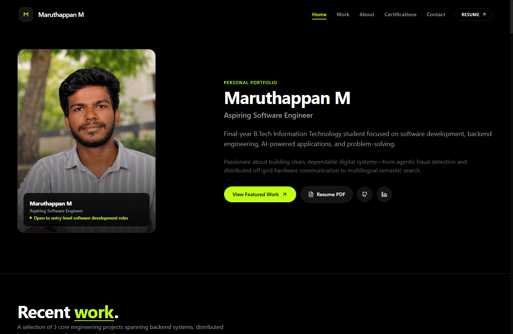

<div align="center">

# Maruthappan M — Software Engineer Portfolio

<p align="center">
  <strong>High-fidelity, editorial portfolio website showcasing distributed systems, backend engineering, IoT communications, and applied AI projects.</strong>
</p>

[](https://maruthappan-portfolio.vercel.app/)
[](https://maruthappan-portfolio.is-a.dev/)
[](https://reactjs.org/)
[](https://www.typescriptlang.org/)
[](https://tailwindcss.com/)
[](LICENSE)

<br/>



</div>

---

## 🌟 Overview

This repository houses the source code for my personal portfolio website, designed and built to present my engineering projects, technical credentials, and internship experiences to recruiters, engineering managers, and collaborators.

- **Production URL:** [https://maruthappan-portfolio.vercel.app](https://maruthappan-portfolio.vercel.app)
- **Custom Subdomain:** [https://maruthappan-portfolio.is-a.dev](https://maruthappan-portfolio.is-a.dev)
- **Resume:** [View Resume PDF](https://maruthappan-portfolio.vercel.app/assets/resume/MaruthappanM_Resume.pdf)
- **LinkedIn:** [linkedin.com/in/maruthappan-murugappan](https://www.linkedin.com/in/maruthappan-murugappan)
- **GitHub:** [github.com/Maruthappan-19](https://github.com/Maruthappan-19)

---

## 🚀 Key Engineering & UX Highlights

* **Pitch-Black Visual Language:** Deep `#000000` pitch-black background with crisp white typography and **Electric Volt (`#c1ff14`)** accents for micro-interactions and status badges.
* **Scroll-Reveal Engine:** Custom intersection-observer-driven line-by-line reveal that reveals content fluidly as the user navigates down the page.
* **Mobile-First Responsive Drawer:** Engineered touch targets ($\ge 44\text{px}$), high-contrast elevated cards, and 1-tap quick actions for recruiters browsing via mobile devices.
* **Interactive Lightbox Inspection:** Modal viewer allowing recruiters to examine high-resolution screenshots and verified certificates in full detail without leaving the view.
* **Spam-Protected Contact Pipeline:** Web3Forms integration featuring honeypot bot traps and real-time validation for direct recruiter inquiries.
* **SEO & Social Share Ready:** Complete Open Graph metadata, Twitter Cards, PWA `manifest.json`, `sitemap.xml`, and Google Search Console verification.

---

## 🛠️ Featured Technical Projects

| Project | Focus Areas | Key Technologies |
| :--- | :--- | :--- |
| **[NexusGuard](https://maruthappan-portfolio.vercel.app/work/nexusguard)** | AI-Assisted Financial Fraud Detection & AML Investigation | Python, FastAPI, XGBoost, Scikit-learn, React |
| **[MeshWave](https://maruthappan-portfolio.vercel.app/work/meshwave)** | Offline Emergency Communication System via Mesh Network | C++, ESP32, LoRa (SX1278), BLE, Android SDK |
| **[SnapSense AI](https://maruthappan-portfolio.vercel.app/work/snapsense-ai)** | Offline Multilingual Screenshot Semantic Search Platform | Python, On-Device Embeddings, OCR, SQLite |

---

## 📂 Repository Structure

The repository is organized following clean monorepo / standalone client architecture:

```text
portfolio/
├── .github/                      # GitHub issue templates and CI workflows
├── docs/                         # Documentation assets & repository preview
│   └── preview.png               # High-resolution README preview banner
├── client/                       # Production Single-Page React Application
│   ├── public/
│   │   ├── assets/
│   │   │   ├── certificates/    # 12 Verified industry certifications
│   │   │   ├── profile/         # Profile photography & social sharing images
│   │   │   ├── projects/        # High-res project galleries & thumbnails
│   │   │   └── resume/          # MaruthappanM_Resume.pdf
│   │   ├── favicon.svg          # Custom SVG favicon
│   │   ├── googleb3fd0a71c4b34f23.html # Google Search Console verification
│   │   ├── manifest.json        # PWA mobile web application manifest
│   │   ├── robots.txt           # Search engine crawler policies
│   │   ├── sitemap.xml          # Production sitemap
│   │   └── _redirects           # SPA routing fallback for Netlify
│   ├── src/
│   │   ├── components/          # Modular UI components (Navbar, Footer, Modal, etc.)
│   │   ├── data/                # Strongly-typed portfolio dataset (projects, certs, timeline)
│   │   ├── pages/               # Routed views (Home, Work, ProjectDetail, About, Certifications, Contact)
│   │   ├── App.tsx              # Root application router & scroll reveal manager
│   │   ├── main.tsx             # React DOM entrypoint
│   │   └── index.css            # Tailwind directives & design tokens
│   ├── package.json             # Frontend dependencies & build scripts
│   ├── tailwind.config.js       # Design theme, volt colors, custom blur utilities
│   ├── tsconfig.json            # Strict TypeScript compiler options
│   └── vite.config.ts           # Vite bundler configuration
├── .gitignore                    # Comprehensive ignore rules
├── LICENSE                       # MIT License
├── package.json                  # Root convenience scripts (npm run dev, npm run build)
├── vercel.json                   # Vercel deployment & SPA rewrite configuration
└── netlify.toml                  # Netlify deployment configuration
```

---

## 💻 Local Development

To run the application locally on your machine:

### Prerequisites
- Node.js (v18 or higher)
- npm (v9 or higher)

### Setup & Run
```bash
# 1. Clone the repository
git clone https://github.com/Maruthappan-19/portfolio.git
cd portfolio

# 2. Install dependencies
npm run install

# 3. Start development server
npm run dev
```

The application will be accessible at `http://localhost:5173`.

### Production Build
```bash
# Create an optimized production build
npm run build

# Preview the production build locally
npm run build --prefix client && npm run preview --prefix client
```

---

## 📬 Contact & Connect

**Maruthappan M**  
*Aspiring Software Engineer — Tiruchirappalli, Tamil Nadu, India*

- **Email:** [maruthappanm2006@gmail.com](mailto:maruthappanm2006@gmail.com)
- **Phone:** [+91 9360596629](tel:+919360596629)
- **LinkedIn:** [linkedin.com/in/maruthappan-murugappan](https://www.linkedin.com/in/maruthappan-murugappan)
- **GitHub:** [github.com/Maruthappan-19](https://github.com/Maruthappan-19)

---

<div align="center">
  <sub>Built with ❤️ by Maruthappan M • Licensed under the MIT License</sub>
</div>
